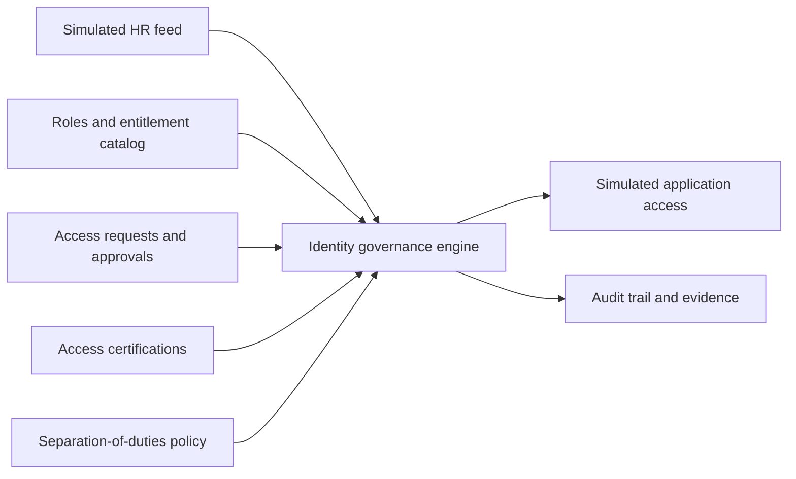

# Identity Governance Lab

A hands-on identity governance simulation for a fictional company, Northstar Labs. This project models SailPoint-style IGA concepts without using a SailPoint tenant, product, or connector. All identities and business data are fictional.

## Project status

The portfolio owner personally validated HR baseline calculation, additional-access requests, two approval stages, SoD blocking and denial, certification revocation, persistent baseline JML, integrated termination revocation, pending-request cancellation on transfer, and repeat imports. See [26 screenshots and results](evidence/README.md). Code and documentation were AI-assisted; the learner edited fictional HR inputs, ran commands, and validated outcomes. This is not SailPoint product experience.

See the [reproduction guide](docs/reproduce.md) and [results and limitations](docs/lab-results.md). Requires Python 3.10+ and only its standard library. Run `python -m unittest discover -v` for 26 distinct unit tests.

Run `python import_hr.py` with Python 3, or run `./Run-HR-Import.ps1` in PowerShell. The import validates the feed, correlates records by employee ID, and writes calculated baseline access to `runtime/baseline-preview.json`. It is a preview, not persistent provisioning or lifecycle reconciliation. Invalid records reject the complete import.

## Business scenario

HR is the authoritative source for employee identity attributes. Department roles provide baseline access. Additional access requires a business reason and approval. Managers periodically certify access. Transfers remove obsolete department access, departures revoke all access, and separation-of-duties policies prevent incompatible financial permissions.

## Planned phases

| Phase | Deliverable | Validation |
|---|---|---|
| 1. HR feed | Fictional employees and manager relationships | Import and correlate by immutable employee ID |
| 2. Roles and entitlements | Department roles and application permissions | Baseline access matches department |
| 3. Requests and approvals | Request, manager review, application-owner review | No access before required approvals; no self approval |
| 4. Certifications | Manager review of request-based grants | Revocation with reason and recorded removal; no scheduled campaign |
| 5. Joiner/Mover/Leaver | HR-driven lifecycle transitions | Joiner gets baseline; mover loses old access; leaver loses all access |
| 6. Separation of duties | Payment creation versus approval conflict | Block final grant; existing-conflict scanning not implemented |
| 7. Portfolio evidence | Results, screenshots, architecture, reproducible instructions | Publish only demonstrated results |

## Architecture

## Start here

Read the [hands-on guide](docs/hands-on-guide.md), inspect the [HR feed](data/hr-feed.csv), and compare it with the [access catalog](data/access-catalog.json).

## Request lifecycle integration

`reconcile_hr.py` revokes granted additional access on termination or department transfer and cancels pending requests for those events or a changed manager. Integrated termination and transfer cancellation were personally validated. Missing HR records are not treated as termination. Review and grant commands also check current HR eligibility. Run one command at a time: request and baseline files are saved separately, with request revocations first, and do not provide database transactions or concurrent-write protection.

## Limitations

This is an educational simulation, not a SailPoint implementation. Application access is represented locally, not provisioned into live systems. Authentication, production authorization, connector retries, external reconciliation, and enterprise-scale operation are outside the initial scope.

Reviewer IDs are simulated CLI inputs, not authenticated logins. Certification covers request grants only; baseline certifications, scheduled campaigns, and existing-conflict scanning are not implemented. JSON history is editable and not tamper-proof. `data/hr-feed.csv` contains the final exercise state; `data/hr-feed-start.csv` provides the original fictional identities for reproduction. Runtime state is excluded from Git.
